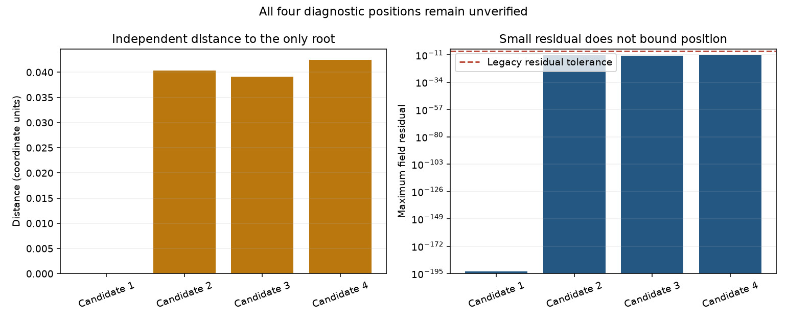

# Intersection residual is not root position

Version 0.27.0 adds a compatible, opt-in way to inspect uncertain candidates.
It does not silently change the legacy finder or claim the false-contact
acceptance problem is generally solved.

## Exact reproduction and independent oracle

For y-x**8=0 versus y=0, search_range=2, grid_resolution=50 and tolerance=1e-8,
the legacy finder returns four points. Analytically y=0 implies x**8=0, so the
only isolated root is (0,0). A 160-digit Decimal calculation of the exact binary
float coordinates measures three candidate distances about .0391, .0403 and
.0425, although both field residuals are below 1e-8 (about 1e-12). The remaining
candidate is about 6.83e-25 from the origin. Raw [reproduction and Decimal data](intersection_diagnostics_reproduction_work17.json)
make residual and true position distinct; the supplied coordinates are not
rounded into exact roots to create the oracle.

The old list API's default detect_overlap=False path remains an approximate
residual/trim-filtered candidate search. Legacy overlap mode may return
unrefined coarse points.
It still returns those four points. Its result must not be interpreted as a
verified position or complete isolated-root list. Reducing iteration budgets
already worsened this case in 0.26 and is not used here. A generic condition
cutoff would also reject the legitimate flat origin and close real crossings.

## Public supplied-candidate diagnostic API

    from geometry import diagnose_intersection_candidates
    from geometry.curve_intersections import find_curve_intersections

    candidates = find_curve_intersections(first, second, tolerance=1e-8)
    evidence = diagnose_intersection_candidates(
        first, second, candidates, position_tolerance=1e-6
    )

Every candidate_report has position_status="position_unverified",
position_verified=False, positional_error_bound=None and isolated_root_status=
"not_established". The entire report is uncertified, with completeness and
overlap unassessed. Even a transverse zero-residual point never gains a
certificate. Empty supplied candidates do not establish disjointness.
No search, point filtering, root merging, registry notification, scene command
or new solver acceptance occurs. Legacy finder results and numerical traces
stay unchanged. Opt-in probes invoke caller code; stateful/noisy callbacks can
change between samples and have no general stability guarantee.

Each field gets an actual finite scalar residual and a bounded Richardson
central-difference gradient/error estimate from its active public evaluator.
Stored symbolic gradients cannot bypass a replacement callback. Both Jacobian
rows, residuals and derivative-error rows are scaled together using a safe
maximum-component normalization before SVD/linear solution. This avoids changing
the linearized equations when fields are rescaled, and handles representable
large/small coefficients without squaring raw norms. Overflow, nonfinite or
unrepresentable evidence becomes unavailable instead of a confident zero.

The normalized reciprocal condition warns below sqrt(machine epsilon), about
1.49e-8. A model is unresolved when its smallest sampled singular value is zero
or no larger than eight times the normalized heuristic derivative uncertainty.
These are warning heuristics, not certified perturbation/error bounds. A
singular/unresolved model has no reported displacement. Otherwise the reported
linearized_displacement solves the locally evaluated field equations. It is
neither distance to a root nor an upper/lower root-error bound; it can badly
underestimate the true error, as x**8 demonstrates. It also does not guarantee
a correction into a trimmed set.

The three far x**8 points have sampled rcond around 1e-9, plus local displacements
around .005 exceeding the requested spatial tolerance. Their actual errors are
about eight times larger. The true flat contact also has an ill-conditioned or
unresolved linear model and remains in the report as position-unverified.
Both close genuine crossings remain separate supplied candidates.

position_tolerance is only a user spatial comparison scale for a displacement
warning. It is not a field-residual tolerance and does not alter solver policy.
Optional derivative_scale=(sx,sy) sets finite-difference stencil scales, not a
coordinate metric. Field scaling and spatial scaling with matching stencils are
regression-covered; extreme underflow or unresolved tiny features can still
remove evidence. Raw residuals are reported without inventing a pass tolerance.

Trim evidence is separate: existing contains callbacks retain their default
arguments when trim_tolerance=None, or receive the explicitly supplied trim
tolerance as their third positional argument. One actual boolean is required; NaN, strings, integers, ambiguous
arrays and exceptions yield unavailable evidence. Contains/excluded is the
callback's answer at that tolerance, not an independent root-position proof.
All points, including excluded or unavailable ones, remain explicitly unverified.

## Regression example and review

    python examples/intersection_uncertainty_demo.py --output uncertainty-example

The [example](../examples/intersection_uncertainty_demo.py) exports JSON containing
the diagnostic report and independent 160-digit oracle, plus a standalone plot.

The 72 new regressions cover the exact four-point reproduction, true flat
quadratic/quartic/x**8 contacts, analytically transverse lines and Newton
quotients, near misses, distinct close crossings, field factors 1e-200 to 1e200,
geometric scales .001/1/1000, procedural/replaced evaluators, scalar callbacks,
trim defaults/booleans/errors, nonfinite/maxfloat/underflow/aliasing evidence,
invalid input and coincidence. Independent read-only review reproduced and
corrected two trim-evidence issues before final approval. The initial affected
suite passed 270 tests before the final 11 trim regressions; the final diagnostic
suite passes all 72. Full milestone CI is recorded in the PR/handoff.

All nine prior complete solver traces are unchanged: ordered field-input/output
hashes, seeds, solutions, nfev, statuses/messages and point lists match recorded
0.26 data. [Parity summary](intersection_diagnostics_trace_parity_work17.json)
links the preserved hashes and counts; full current traces are retained in the
Work17 handoff. This evidence concerns the controls, not universal certification.

## Bounded opt-in costs

Five warm complete diagnostic calls, Work17 Python 3.11.14:

| Supplied-candidate workload | Median ms | Direct scalar field probes |
|---|---:|---:|
| reproduced_x8_candidates | 1.3966 | 80 |
| true_flat_origin | 0.3405 | 20 |
| transverse_offset | 0.3510 | 20 |
| two_flat_crossings | 0.7332 | 40 |
| near_miss | 0.3511 | 20 |
| trim_excluded | 0.3461 | 20 |
| coincident_sample | 0.3776 | 20 |

These are extra diagnostic costs, separate from unchanged numerical root search.
Each field uses at most ten direct scalar probes per supplied point, plus an optional
contains call whose internals are not counted. Arbitrary callback runtime is
not bounded by the probe count. [Raw costs and reports](intersection_diagnostics_costs_work17.json)
include all five batches. There is no speedup, FPS or positional-accuracy claim.

Reproduce the portable measurement and trace comparison from a checkout:

    python benchmarks/iterative_tangency.py --repository . --label current --output solver-traces.json
    python benchmarks/intersection_diagnostics.py --output diagnostic-costs.json --reproduction docs/intersection_diagnostics_reproduction_work17.json --solver-traces solver-traces.json
    python -m pytest tests/test_intersection_diagnostics.py

## Remaining correctness limits

A general safe rejection rule or actual positional enclosure remains unresolved.
Finite probes, condition numbers, solver status and small residuals cannot prove
arbitrary black-box root positions, isolation or absence of hidden features.
Applications needing verified geometry must obtain independent positional
evidence appropriate to their supported field model. This API exposes uncertainty
rather than treating those candidates as verified intersections. Quadratic/line
acceleration remains deferred; no new symbolic root solver, dependencies, scene
format, deployment, security or main changes are included. Native WebMCP host
verification remains separate.
