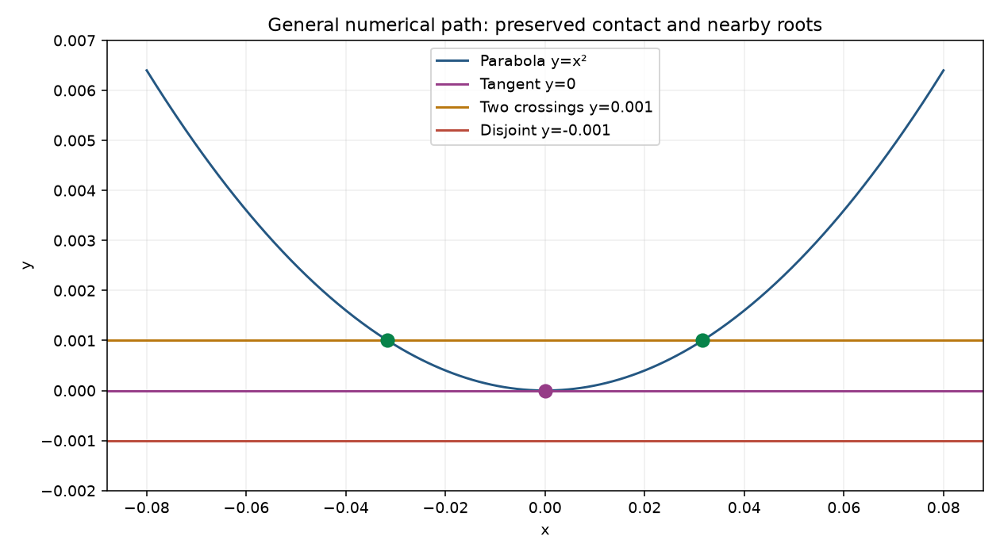

# General numerical tangency cost

Version 0.26.0 profiles and reduces the cost of the existing numerical path.
It does not add a tangency solver or alter convergence and acceptance rules.

## Profile before implementation

The reproduced control intersects y-x*x=0 with y=0 over [-2,2], grid 100,
tolerance 1e-8. It returns one approximate origin contact, after 62 fsolve starts
and 37,324 system evaluations. Every start reaches status 2 at maxfev=600 (602
reported nfev). The recorded final points shrink to about 1e-125, with successive
starts ultimately deduplicated. A cProfile run attributes about 98% of time to
fsolve and most field evaluation overhead to coordinate normalization/broadcasting.
Its instrumented 4.93 s is not the warm complete-call baseline. See the
[profile summary](iterative_tangency_profile_work17.json).

## Bounded implementation

After both inputs pass the existing real_array validation and float conversion,
broadcast_coordinates returns them directly when their shapes already match.
This avoids redundant np.broadcast_arrays dispatch and shape work for scalar
solver coordinates and equal-shaped grids. NumPy already returned those same
arrays for equal shapes: this change does not claim to eliminate new array views.
Unequal shapes retain NumPy broadcasting. Complex/object/string rejection,
scalar versus zero-dimensional array results, dtype, aliasing, signed zeros,
strides, read-only flags and empty arrays retain their existing contracts.
Active public evaluators still receive the same coordinate objects/types.

No candidates are pruned or cached, and no direct compiled callback bypass is
added. All starts, solver budgets, relative xtol, field scaling, deduplication,
actual residual and final trim checks remain. Recognized native circle contacts
still take the 0.25 path, and 0.24 thin-trim/endpoint recovery remains covered.
There are no API, scene, dependency, main, security or deployment changes.

## Why not shorten iteration budgets?

An experimental maxfev=80 cap made the simple parabola faster. On y-x**8 versus
y, however, it increased returned points from four to 24, despite the analytic
set having only one isolated contact at the origin. The uncapped legacy result
already includes false contacts near |x|=.04; the cap adds many estimates around
1e-4 to 1e-3. The quartic cap also worsens coordinate error from about 1e-52 to
1.4e-7. Small field residual is not a positional certificate, particularly at
high-order contacts. The cap is not shipped; neither are looser tolerances or
blanket suppression of nearby solver starts. Raw [budget evidence](iterative_tangency_budget_work17.json)
records both the existing failure and the rejected experiment.

## Analytic demonstration and regressions

    python examples/parabola_contact_demo.py --output parabola-example

The [example](../examples/parabola_contact_demo.py) exports validated JSON and a
standalone plot: y=0 has one contact, y=.001 has two crossings at +/-sqrt(.001),
and y=-.001 is disjoint. Observed errors are measured against those independent
analytic references, not inferred from residual size.

The 273-test focused suite includes 62 new cases for coordinate contracts plus
parabola/line contact, near miss, two true crossings, curve order, geometric
scales .01/1/1000, procedural and replaced evaluators, trims/endpoints, callback
rejection/failure, quartic deduplication, coincidence and retained circle results.
Independent review approved the source and independently checked all nine raw
benchmark rows. Every ordered solver input/field-output trace SHA-256, seed,
solution, termination status/message, nfev, root list and count is identical
before and after. Hashes cover the separate trace-validation call; timing calls
do not compute hashes. This is strong parity evidence for these controls,
not proof of arbitrary callback behavior or universal numerical completeness.

## Complete-call costs

Five warm sequential batches per version, Work17 Python 3.11.14 / NumPy 2.4.6:

| Workload | 0.25 ms | 0.26 ms | Points | Starts (unchanged) | System calls (unchanged) |
|---|---:|---:|---:|---:|---:|
| parabola_origin | 1945.935 | 1128.215 | 1 | 62 | 37324 |
| parabola_translated | 137.615 | 114.566 | 1 | 49 | 1908 |
| procedural_parabola | 700.966 | 352.498 | 1 | 23 | 13846 |
| quartic_contact | 2153.789 | 1589.391 | 1 | 64 | 38528 |
| near_two_crossings | 74.644 | 32.151 | 2 | 50 | 728 |
| near_disjoint | 123.757 | 76.178 | 0 | 50 | 2150 |
| trimmed_contact | 94.609 | 85.802 | 1 | 27 | 2063 |
| recognized_circle_contact | 0.644 | 0.620 | 1 | 0 | 0 |
| coincident_parabolas | 0.689 | 1.177 | 0 | 0 | 0 |

The sequential batches show substantial workstation variance. The primary
magnitude check therefore alternates old and new validated broadcast helpers
within the same isolated process, restoring every imported binding afterward.
Five complete-call pairs measured median wall times **1975.318 ms before /
1472.875 ms after** (about 25% lower), with process CPU medians **1968.750 /
1453.125 ms**. The points remain identical. No result cache or shorter solver
budget contributes to the improvement. All 62 starts and 37,324 evaluations
remain; general tangencies can still be expensive.

Raw [0.25](iterative_tangency_0.25.0_work17.json),
[0.26](iterative_tangency_0.26.0_work17.json) and
[paired data](iterative_tangency_paired_work17.json) include all timing batches
and trace evidence. Timings include grid evaluation, clustering, solver work,
final checks and result creation. They do not establish universal latency/FPS
or improved geometric accuracy. Sub-millisecond circle/coincidence timing
differences are dominated by noise and are not improvement claims.

    python benchmarks/iterative_tangency.py --repository . --label current --output iterative-costs.json
    python -m pytest tests/test_coordinate_broadcast.py tests/test_backend_numerics.py tests/test_tangent_intersections.py tests/test_trimmed_intersections.py

The same-process paired check is a Work17 investigation script recorded in the
handoff, rather than an application runtime feature. Separate-version complete
calls and trace hashes can be reproduced with the checked-in benchmark above.

## Evidence-backed next opportunities

1. A bounded native quadratic/line double-root classifier could avoid the costly
   origin-parabola iteration path, using the existing native-kernel authority
   guards and actual residual/mask acceptance. It should remain a supported
   coefficient specialization, not a promise for procedural or general curves.
2. The reproduced x**8 false contacts need condition/position diagnostics or a
   justified local geometric error bound. Relative xtol and residual tolerance
   alone cannot distinguish those estimates from certified contact coordinates.
   Candidate pruning or early convergence should wait for that evidence.

Coincident fields/overlap remain separate from isolated roots. Existing coarse
overlap heuristics, arbitrary callback/mask behavior, close-root merging and
grid completeness limits remain; native WebMCP host verification is separate.
