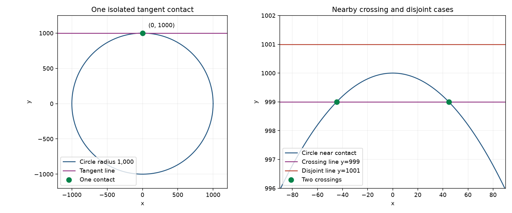

# Bounded native circle tangencies

Version 0.25.0 addresses reproducible isolated-contact failures in the existing
find_curve_intersections API. At radius 1000, x*x+y*y=1000000 against y=1000
returned two nearby points instead of the single contact (0,1000); the default
500-grid workload returned three. Equal circles centered at (0,0) and (2000,0),
or (1200,1600), also returned duplicate tangencies. At unit radius, scaling both
circle and tangent-line fields by 1e-12 made the old sampled identity check
mistake the fields for coincidence and return no point. The new native path
returns one accepted contact in each example without widening deduplication.

## Recognition and acceptance

Recognition is bounded to native ImplicitCurve evaluation (including inherited
ConicSection/PolynomialCurve behavior) and default TrimmedImplicitCurve wrappers.
The structural degree check rejects unsupported or high-degree input before
polynomial expansion; expression operation count is capped at 256. Only degree
two or lower rational/Float-coefficient circle or line fields are recognized.
Stored Float atoms are converted to their exact rationals before expansion,
matching the existing bounds convention. No general symbolic root solving occurs.

A circle/line discriminant must be exactly zero for those stored coefficients.
Circle/circle subtraction supplies the radical axis and the same check. Nonzero
discriminants always fall back; no fuzzy tangent classification combines nearby
crossings. Coincident native circles return no isolated points, rather than
enumerating a continuum. This is not a general overlap or trimmed-overlap solver.

Recognition guards the public evaluator, native property descriptors and compiled
kernel identity plus expression/variable snapshot. Live setters invalidate the
snapshot. Custom public/private evaluators, procedural fields, level sets and
unsupported expressions retain the existing iterative path. A supplied symbolic
expression is not authority to bypass an active replacement callback.

The isolated contact is converted to float coordinates, then checked against
the actual finite values of both active fields and the existing residual
tolerance. Final contains/mask callbacks, search bounds, max_points and registry
callbacks remain authoritative. Failed residual acceptance or raising masks
fall back to preserve legacy behavior. A mathematically valid contact can fail
floating evaluation after severe translation or overflow and is not forced in.
Independent review found overflow acceptance in the initial native shortcut
when it reused the numerical solver's finite failure sentinel at tolerance 1e7.
Native acceptance now requires actual finite field values separately from that
sentinel; the overflow regression returns no contact.

The 0.24 trim halo, endpoint starts and original unpadded overlap heuristic
inputs/activation threshold remain. Legacy numerical overlap heuristics for
other fields can still produce coarse unrefined approximations. No API, scene
format, new dependency or global duplicate threshold changes are introduced.

## Demonstration and analytic checks

    python examples/tangent_intersection_demo.py --output tangent-example

[Example source](../examples/tangent_intersection_demo.py) exports JSON plus this
standalone plot. At radius 1000 the tangent returns (0,1000), the line y=999
returns two crossings at x=+/-sqrt(1999), and y=1001 is disjoint. Additional
cases cover external circle contact, coincidence and a retained trim endpoint.
These are validated float coordinates usable as cutting/anchor inputs.

The 244-test focused suite includes 104 new cases spanning radii .001, 1 and
1000, reversed inputs, native/conic and compiled calls, transformed/scaled fields,
near crossings/disjoint cases, strict and closed endpoint trims, deduplication,
coincidence, evaluator replacement, live edits, search/point limits and callback
behavior. Nextafter discriminants test recognition only; they do not establish
all near-disjoint API results at every field tolerance. Independent review also
checked 24 unequal/transformed rational contact pairs and a nonsquare radius.

## Accuracy and complete-call cost

Sequential warm medians from five complete calls on Work17, Python 3.11.14 and
NumPy 2.4.6 (same dependencies, separate version processes):

| Workload | 0.24 ms | 0.25 ms | Points before / after | Solver starts before / after |
|---|---:|---:|---:|---:|
| large_circle_line | 51.650 | 0.395 | 2 / 1 | 26 / 0 |
| large_external_circles | 4.888 | 0.395 | 2 / 1 | 8 / 0 |
| large_oblique_circles | 5.229 | 0.447 | 2 / 1 | 8 / 0 |
| large_circle_line_default_grid | 626.764 | 0.320 | 3 / 1 | 76 / 0 |
| scaled_unit_fields | 0.341 | 0.403 | 0 / 1 | 0 / 0 |
| near_crossing | 212.320 | 40.800 | 2 / 2 | 26 / 26 |
| near_disjoint | 309.966 | 61.941 | 0 / 0 | 26 / 26 |
| trimmed_endpoint | 31.633 | 1.275 | 1 / 1 | 11 / 0 |
| thin_trim_crossing_control | 13.438 | 12.201 | 1 / 1 | 12 / 12 |
| parabola_tangent_control | 2052.631 | 2053.841 | 1 / 1 | 62 / 62 |

Recognized large contacts took about .3-.45 ms here, avoiding the grid/refinement
path and all fsolve starts. Their float coordinates matched the analytic
references with zero observed error; this is not certified positional accuracy.
The scaled-field case recovers a missed root at a small additional measured cost.
The parabola tangent still takes about 2 seconds and uses the existing solver.

Fallback control solver counts are unchanged. Near crossing/disjoint wall times
vary substantially between the sequential runs on this shared workstation;
they do not demonstrate a new fallback acceleration or an FPS guarantee.
Timing includes classification, actual evaluation, masks and all other complete
call work. Counters cover fsolve starts/system calls, not final field evaluations
or unknown callback internals. No query-result cache is involved.

Raw [0.24](tangent_intersections_0.24.0_work17.json) and
[0.25](tangent_intersections_0.25.0_work17.json) results record all five batches,
returned points, analytic references, coordinate errors and solver counters.

    python benchmarks/tangent_intersections.py --repository . --label current --output tangent-costs.json
    python -m pytest tests/test_tangent_intersections.py tests/test_trimmed_intersections.py tests/test_trimmed_implicit_curve.py tests/test_implicit_curve.py tests/test_sublevel_bounds.py

Floating coefficients often describe a near-tangency rather than an exact
stored-coefficient contact. Those and arbitrary fields remain grid-seeded,
approximate and incomplete. Functional residual is not a universal positional
bound; very close roots can still be merged or missed. This bounded special case
does not guarantee all tangencies or replace general numerical intersection work.
