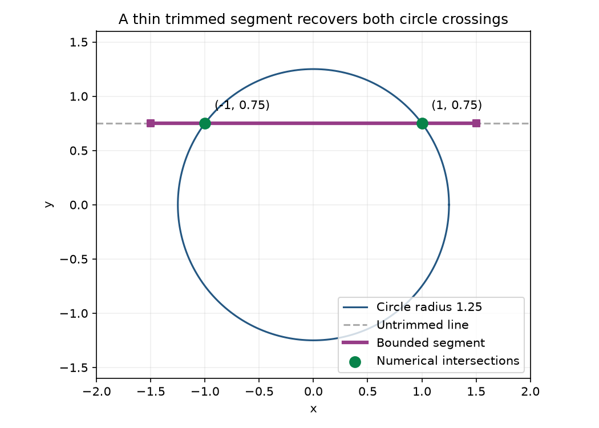

# Thin trimmed-curve intersections

Version 0.24.0 fixes a concrete candidate-generation failure in the existing
find_curve_intersections API. A trimmed segment on y=0.25 with x in [0,1] has a
valid zero-height rectangle. At 100 grid samples over [-2,2], no sampled y is
0.25: exact rectangle clipping discarded every seed and returned no crossing
against x=0.5 or x=1. Removing only the rectangle recovered the interior root.
Representative untrimmed parabola/circle tangencies already worked; this
milestone does not replace their solver.

## Bounded change

Coarse rectangle filtering now retains a halo of one actual linspace interval,
2*search_range/(grid_resolution-1), around complete finite rectangles. Those
samples are solver starts, not returned points or permission to expand a trim.
The old clustering/coarse residual scales stay unchanged. Partial rectangles
are not exclusion proofs; they skip the coarse filter, consistently with the
existing contains contract, rather than raising an error for missing bounds.

Finite, in-range explicit endpoints are appended after grid clustering. They
cannot be averaged away or discarded with an empty grid candidate set. A tiny
binary-radius circle with a strongly scaled implicit function demonstrates
recovery from an explicit endpoint when the grid yields no candidates. Removing
that endpoint still misses the tiny feature, honestly preserving the bounded
search's completeness limit.

The existing solver, residual tolerance, final contains/mask checks, duplicate
thresholds, max_points, search checks and registry callbacks remain in charge.
Arbitrary callable masks are evaluated at refined points; they are not padded.
Both curve orderings, interior/closed-endpoint crossings, partial rectangles,
narrow arcs and exclusions are regression-covered. Supplied endpoints are
untrusted seeds; malformed/nonfinite/out-of-range entries are ignored.

Legacy detect_overlap=True remains an approximate coarse heuristic. Both its
input set and >20 activation threshold use the original unpadded rectangle
filter. Newly padded candidates must refine. Independent review reproduced an
aligned rectangle with 13 original candidates: using the padded count activated
the heuristic and returned false points. The final implementation retains the
original threshold, and the aligned case returns both real crossings in either
mode. This does not add a general overlap solver or validate all legacy coarse
overlap outputs.

## Reusable example

From a development checkout with the declared geometry dependencies:

    python examples/trimmed_intersection_demo.py --output intersection-example

[Example source](../examples/trimmed_intersection_demo.py) intersects the bounded
horizontal segment [-1.5,1.5] at y=0.75 with the circle x*x+y*y=25/16.
The analytic references are (-1,0.75) and (1,0.75). The numerical implementation
now returns both, accepted by the final trim, for use as cutting or anchor
coordinates. The script checks agreement within 1e-7 and exports intersections.json
plus intersections.png. The measured example happened to match the references
exactly as floats; it remains an approximate numerical API, not an exact proof.

The example adds no scene commands, UI controls or serialized function formats.
The existing studio remains compatible.

## Analytic evidence and realistic costs

The 108-test focused suite includes 43 new cases: three grid resolutions, both
curve orderings, zero-height/width rectangles, tiny diagonal trims, circle and
parabola roots, a narrow circle arc, shared endpoints and duplicate rejection,
strict/callback masks, final rectangle exclusions, empty-grid explicit seeds,
partial bounds, registry calls, limits/live edits and retained tangencies.
Independent review checked the corrected overlap trigger and final residual/
containment authority. Full exact feature/dev CI gates are recorded in the PR.

Sequential warm complete-call medians, Work17 Python 3.11.14/NumPy 2.4.6:

| Workload | 0.23 ms | 0.24 ms | Roots before / after | Grid candidates | Solver starts |
|---|---:|---:|---:|---:|---:|
| thin_interior_100 | 0.412 | 2.777 | 0 / 1 | 10 | 12 |\n| thin_interior_500 | 16.888 | 19.275 | 0 / 1 | 30 | 32 |\n| thin_endpoint_100 | 0.355 | 2.256 | 0 / 1 | 8 | 10 |\n| thin_circle_crossings_100 | 0.369 | 2.703 | 0 / 2 | 8 | 10 |\n| thin_outside_root_100 | 0.345 | 1.460 | 0 / 0 | 6 | 8 |\n| partial_rectangle_100 | 0.344 | 5.765 | error / 1 | 25 | 27 |\n| untrimmed_circle_crossings_100 | 6.517 | 5.744 | 2 / 2 | 22 | 22 |\n| untrimmed_parabola_tangent_100 | 1938.136 | 2176.411 | 1 / 1 | 62 | 62 |

Baseline empty/error cases skip useful refinement, so these are correctness
costs, not speedup claims. The recovered 100-grid interior/circle cases take
about 2.7 ms here; the default 500-grid interior takes about 19 ms. The existing
untrimmed parabola tangent remains costly (about 2.2 seconds, 37,324 solver-system
calls in this instrumented workload); improving its refinement strategy would
be a separate evidence-led increment. No FPS or universal latency guarantee.

Raw [0.23](trimmed_intersections_0.23.0_work17.json) and
[0.24](trimmed_intersections_0.24.0_work17.json) results include five measured
batches, returned points, errors and counters. Counters cover clustering input
and calls to the system inside fsolve; they omit final residual/tangent/trim/
identity evaluations and unknown callback internals. Timing includes complete
calls with grid evaluations, clustering, refinement and final checks.

Reproduce each version in a separate process with the same dependencies:

    python benchmarks/trimmed_intersections.py --repository . --label current --output intersection-costs.json
    python -m pytest tests/test_trimmed_intersections.py tests/test_trimmed_implicit_curve.py tests/test_sublevel_bounds.py

Grid resolution, residual field scaling, difficult singular tangencies and
existing duplicate thresholds still affect results. A functional residual is
not a universal positional error bound. Close roots can remain merged or
missed; arbitrary masks can reject a numerically displaced endpoint. This is
a targeted trim-candidate recovery, not a general symbolic or certified solver.
